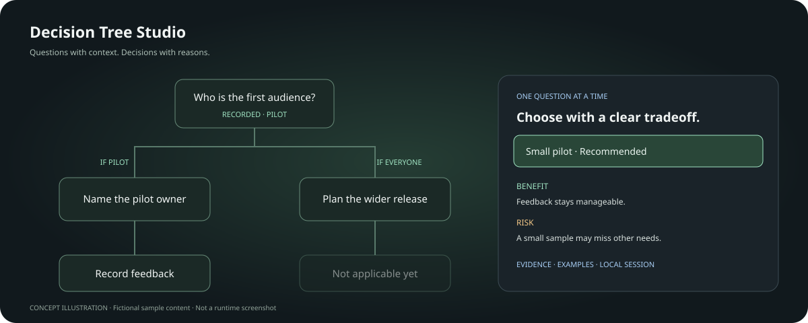

# Decision Tree Studio

**Bring the questions. See the dependencies. Record decisions with their reasons.**

A local-first React workspace that turns a JSON document into an interactive decision tree. Built for product decisions, research reviews, onboarding and other structured questionnaires where some questions depend on earlier answers.

[فارسی](README.fa.md) · [Data format](docs/data-format.md) · [Architecture](docs/architecture.md) · [Validation](docs/QA.md) · [Roadmap](ROADMAP.md)



## What it does

- Creates topics, questions and conditional branches from your own JSON.
- Distinguishes **recorded**, **ready**, **blocked**, **deferred**, **needs review** and **not applicable**.
- Supports explicit prerequisites and `all` / `any` conditions across questions.
- Keeps the recommendation selected for review without treating it as a recorded answer.
- Presents one question at a time, with options, benefits, risks, examples, outcomes and traceable sources.
- Explains excluded paths instead of offering an irrelevant answer form.
- Flags saved downstream decisions when an earlier answer or question definition changes.
- Saves projects, answers, option drafts, note drafts, annotations and preferences in browser storage.
- Offers undo/redo, session reset, search, status filtering, a keyboard-friendly list and graph navigation.
- Adds contextual notes with **Alt + click** on nodes or connections; notes can also be added from question dialogs.
- Exports complete portable sessions or clean document definitions. Clipboard failure has a manual-copy fallback.
- Includes English and Persian interfaces, RTL documents, light/dark themes, local fonts and reduced-motion support.

**This is a single-user application.** It does not generate research, verify sources, call an AI model, enforce a business policy on a server or synchronize between browsers. The included launch-workflow examples are fictional author proposals, clearly labelled as such.

## Run locally

Requirements: **Node.js 24.15 or later**, npm, and a modern browser.

```sh
npm ci
npm run dev
```

Open the local URL printed by Vite. The development server binds to `127.0.0.1`.

```sh
npm run check       # lint → tests → TypeScript and production build
npm run build
npm run preview     # preview the built application on localhost
```

Keep using the same origin/port to retain browser storage. A different browser, profile or port has a separate workspace. Export a session before clearing browser data.

## Start with your own content

1. Open **Import / edit JSON**.
2. Load a starter, edit the current document or choose a JSON file.
3. Validate and open it. Invalid imports leave the current workspace intact.
4. Record applicable questions using **Next question**, the graph or the list.
5. Copy or export the full session for review.

Document imports with an existing document ID preserve its session for review; importing a **complete session** intentionally restores that session for its document ID. Use a new ID for an independent project.

See [the full format and a minimal example](docs/data-format.md). Ready-to-edit examples are in [public/examples](public/examples).

## Controls

| Action           | Control                                                     |
| ---------------- | ----------------------------------------------------------- |
| Pan              | Drag empty canvas; Space + drag; middle drag                |
| Zoom             | Ctrl + wheel, pinch, or graph controls                      |
| Open a question  | Click its card; use the list for sequential keyboard access |
| Add context note | Alt + click a node/connection, or Add a note in a dialog    |
| Search           | `/` outside text inputs                                     |
| Undo / redo      | Ctrl/Cmd + Z / Shift + Z outside text inputs                |
| Close a dialog   | Close button, Escape, or click outside                      |

Questions may be independent or conditional. You answer **all applicable decisions**, not just one of the top-level topics. Inactive branches are excluded from progress; deferred decisions remain open. A recommendation becomes an answer only after **Record answer**.

## Stack and design choices

| Responsibility                   | Library                                |
| -------------------------------- | -------------------------------------- |
| Interface                        | React + TypeScript                     |
| Interactive graph                | React Flow                             |
| Automatic hierarchy layout       | Dagre                                  |
| Workspace state                  | Zustand vanilla store + React bindings |
| Runtime validation               | Zod                                    |
| Dialogs and focus handling       | Radix Dialog                           |
| Transitions and gesture feedback | Motion                                 |
| Icons / typography               | Lucide / self-hosted Vazirmatn         |
| Tooling                          | Vite, Vitest, Testing Library, ESLint  |

Persistence is a small versioned adapter around the Zustand store, rather than a second state library. It deliberately preserves unreadable backups instead of silently overwriting them. See [architecture](docs/architecture.md) and [privacy](docs/privacy.md).

## Current limits

Version **0.1.0** is a runnable application, not a published component package. It accepts up to 5,000 nodes, 5 MiB documents and 20 MiB session imports. These are safety limits, **not a performance guarantee**. Automated tests include a 300-level topic hierarchy; large real graphs and mobile interactions still need browser profiling. The JSON editor is the authoring interface; a drag-and-drop question editor is on the roadmap.

The automated checks cover domain, persistence, import/export, layout and dialog behavior. See [QA](docs/QA.md) for commands and honest evidence limits. There is no claim of a completed real-browser accessibility or responsive audit.

## Contribute

Read [CONTRIBUTING.md](CONTRIBUTING.md), [AGENTS.md](AGENTS.md), and the data format before changing the decision semantics. Keep runtime data validation and pure-engine tests together. Avoid adding dependencies without a concrete use.

## License

MIT for this project's code. Dependencies retain their own licenses. The Vazirmatn font is distributed under the SIL Open Font License; [third-party notices](NOTICE.md) and the bundled font license apply.
