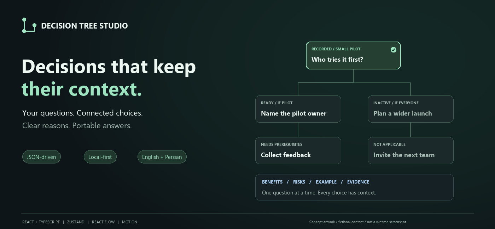

# Decision Tree Studio

### Decisions that keep their context.

Turn a JSON document into a visual decision workspace — with conditional questions, clear tradeoffs, traceable sources and answers you can take with you.

[](https://github.com/amirhoseinLotfii/decision-tree-studio/actions/workflows/validate.yml)
[](LICENSE)
[](package.json)
[](README.fa.md)

**[Get started](#get-started)** · **[Bring your data](docs/data-format.md)** · **[فارسی](README.fa.md)** · **[Architecture](docs/architecture.md)** · **[Roadmap](ROADMAP.md)**



<sub>Concept artwork with fictional content. This is an illustration, not a runtime screenshot.</sub>

## A place for decisions that depend on other decisions

A product review, onboarding plan or policy workshop often has more than a list of questions. One answer changes which questions apply. A new constraint can make an earlier answer stale. The reason for a recommendation can matter as much as the choice itself.

Decision Tree Studio makes those relationships visible. Define the content in JSON, explore the graph, read one question at a time and record the decisions that apply. Keep the explanations, evidence and notes with the answers when you export.

**Single-user. Local-first. No account or AI service required.**

## What you can do

| Capability                           | What it gives you                                                                      |
| ------------------------------------ | -------------------------------------------------------------------------------------- |
| **Bring your own decision document** | Topics, questions, options, examples and sources defined as data.                      |
| **Follow conditional paths**         | Explicit prerequisites plus `all` / `any` conditions, validated before import.         |
| **Make an informed choice**          | Benefits, risks, examples, expected outcomes and evidence for the current option.      |
| **See what changed**                 | Downstream answers move to review when earlier decisions or definitions change.        |
| **Keep context on the graph**        | Notes attached to a node or connection; unfinished note drafts survive a reload.       |
| **Move between graph and list**      | Pan, zoom, minimap, search, status filters and sequential question navigation.         |
| **Carry the work forward**           | Copy/export a complete session, restore it later, or share a clean document.           |
| **Work in either direction**         | English/Persian interface, independent document direction, RTL menus and isolated IDs. |

Recommendations are selected for **review**, never silently counted as answers. Excluded paths explain the recorded choice that made them irrelevant. Deferred questions remain open.

## Get started

Use **Node.js 24.15+**, npm and a modern browser.

```sh
git clone https://github.com/amirhoseinLotfii/decision-tree-studio.git
cd decision-tree-studio
npm ci
npm run dev
```

Open the local URL printed by Vite. The development server binds to `127.0.0.1`.

For a production build:

```sh
npm run build
npm run preview
```

The build is a static application in `dist/`. Serve it over HTTP(S) with a static web server. There is no server API to configure.

## A two-minute walkthrough

1. Open **Import / edit JSON** and choose your own document or session file.
2. Use **Next question** to start with an available decision.
3. Read the question, example, options, tradeoffs and source origin.
4. Choose an option and press **Record answer**. The highlight alone does not save a decision.
5. Explore a conditional branch. Inactive branches show why they do not apply.
6. Add a note, then **Export session** or **Copy for review** from the workspace menu.

The workspace starts empty. No demonstration datasets or automatic projects are shipped. The small JSON snippet below documents the format; it is not loaded into your workspace.

<details>
<summary><strong>What does the document look like?</strong></summary>

```json
{
  "formatVersion": "1.0",
  "id": "first-decision",
  "version": "1",
  "title": "Choose a first audience",
  "nodes": [
    {
      "id": "audience",
      "kind": "question",
      "title": "First audience",
      "prompt": "Who should try the first release?",
      "example": "Five teammates can give feedback before a wider launch.",
      "options": [
        { "id": "pilot", "label": "Start with a small pilot", "recommended": true },
        { "id": "everyone", "label": "Invite everyone" }
      ]
    }
  ]
}
```

The [format guide](docs/data-format.md) covers conditions, dependencies, source kinds, examples and session compatibility. Missing sources are shown explicitly; the app does not manufacture evidence.

</details>

## Understand the status of each decision

| Status                  | Meaning                                                      |
| ----------------------- | ------------------------------------------------------------ |
| **Ready**               | Applicable and available to answer.                          |
| **Recorded**            | Explicitly saved and valid against the current dependencies. |
| **Needs prerequisites** | Another decision must be resolved first.                     |
| **Deferred**            | Intentionally left open.                                     |
| **Needs review**        | A definition or dependency changed after recording.          |
| **Not applicable**      | Current recorded choices exclude this path.                  |

Answer all **applicable** decisions. Topics organize the work; choosing a topic does not replace decisions in the other topics. Inactive questions are excluded from progress.

## Controls that keep you moving

| Action                | Control                                                     |
| --------------------- | ----------------------------------------------------------- |
| Pan                   | Drag empty canvas, middle drag, or Space + drag             |
| Zoom                  | Ctrl + wheel, pinch, or graph controls                      |
| Open a question       | Click its card, use the list or choose Next question        |
| Add a contextual note | Alt + click a node/connection, or Add a note in a dialog    |
| Search                | `/` outside text inputs and select controls                 |
| Undo / redo           | Ctrl/Cmd + Z / Shift + Z outside inputs and select controls |
| Close a dialog        | Close button, Escape or outside click                       |

Keyboard-accessible shadcn/Radix selects, clear focus indicators and Motion transitions are included. Application preferences and OS reduced-motion settings are respected. A complete real-browser accessibility audit is still pending.

## Local data, portable sessions

Projects, answers, option drafts, note drafts and preferences stay in browser storage on the current origin. They are not sent to a server. The application has no analytics, model requests or remotely hosted fonts.

Export before clearing browser data. Another browser, profile or port has a separate workspace. Local storage is not an encrypted vault or guaranteed backup. Unreadable storage is preserved for recovery rather than silently overwritten; write failures show a warning and leave the current in-memory session exportable.

A document import with an existing ID updates the content and preserves its answers for review. A **session import** intentionally restores the session for its document ID. Use a new ID for an independent project. See [privacy and recovery](docs/privacy.md).

## Built to be understood and extended

| Layer                    | Tools                                                        |
| ------------------------ | ------------------------------------------------------------ |
| Interface                | React + TypeScript                                           |
| State                    | Zustand external store with a versioned persistence adapter  |
| Graph + layout           | React Flow + Dagre                                           |
| Runtime contracts        | Zod                                                          |
| Dialogs + selects        | Radix + shadcn/ui                                            |
| Motion + visual language | Motion, Lucide, self-hosted Vazirmatn, semantic theme tokens |
| Checks                   | Vitest, Testing Library, ESLint, TypeScript, Prettier        |

The decision engine is independent of React, the graph and browser storage. The graph is a projection of the document, not the owner of decision validity. Read the [architecture](docs/architecture.md) and [visual system](docs/design-system.md) for the boundaries.

## Quality and current scope

```sh
npm run check         # lint → tests → TypeScript + production build
npm run format:check
```

[GitHub Actions](https://github.com/amirhoseinLotfii/decision-tree-studio/actions/workflows/validate.yml) runs the code checks on pushes and pull requests. The [QA report](docs/QA.md) distinguishes automated evidence from manual checks that are still pending.

Version **0.1.1** is a runnable application, not a published component package. The JSON editor is its authoring interface; a visual drag-and-drop editor is a roadmap item. The current limits are 5,000 nodes, 5 MiB document imports and 20 MiB session imports. These are safety limits, not performance guarantees. Large graph profiling, real-browser mobile testing, screen-reader acceptance and multi-tab conflict handling remain future work.

The app does not generate research, verify citations, synchronize users or enforce policy on your backend.

## Help shape the next version

- [Report a reproducible bug](https://github.com/amirhoseinLotfii/decision-tree-studio/issues/new?template=bug-report.yml).
- [Propose a focused feature](https://github.com/amirhoseinLotfii/decision-tree-studio/issues/new?template=feature-request.yml).
- Read [CONTRIBUTING.md](CONTRIBUTING.md), [the roadmap](ROADMAP.md) and [the changelog](CHANGELOG.md).
- Keep shared examples fictional and source claims attributable; omit private session data from reports.

Created by [AmirHosein Lotfii](https://github.com/amirhoseinLotfii).

## License

[MIT](LICENSE) for the project code. Dependencies retain their own licenses. Vazirmatn uses the SIL Open Font License; the shadcn source notice and font license ship with the build. See [NOTICE.md](NOTICE.md).
